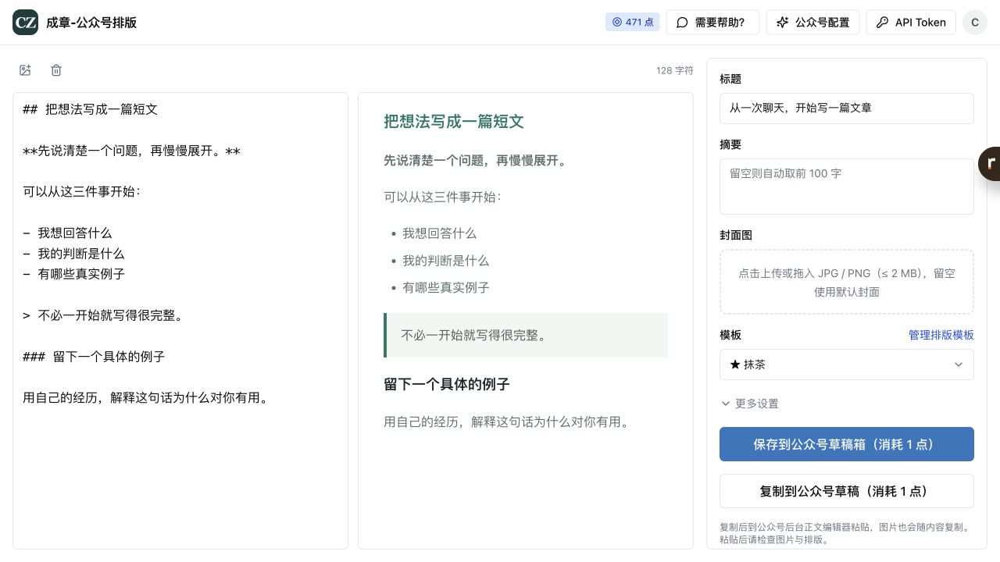
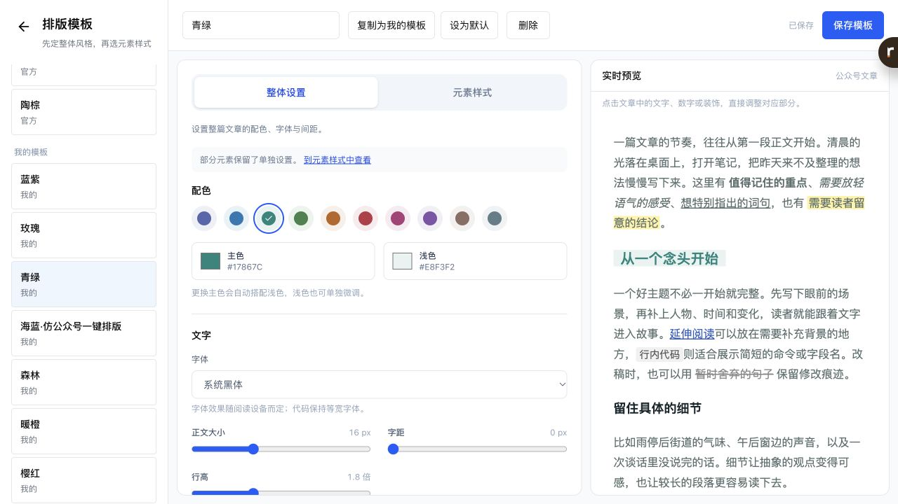
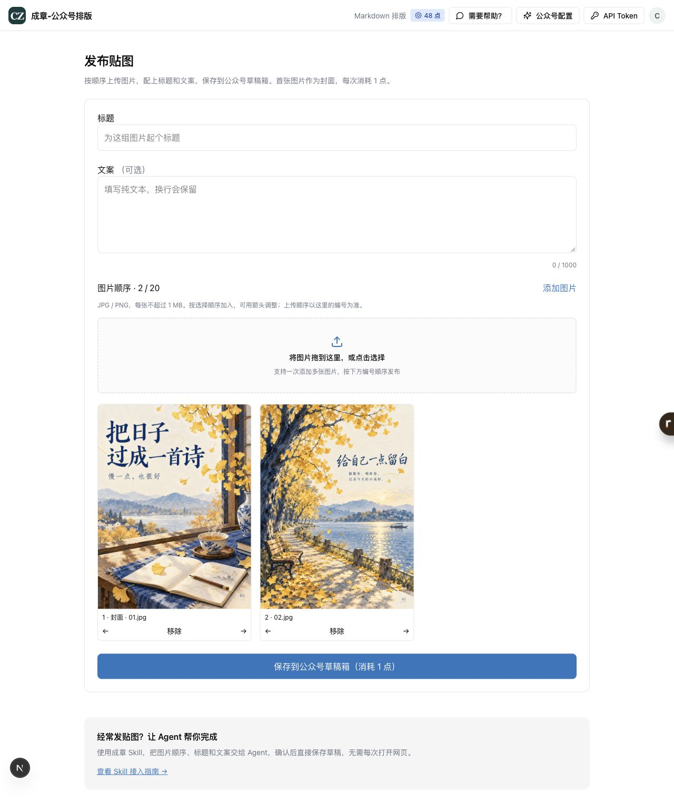

# 成章 Chengzhang

**网页调好排版，让 Agent 把文章送进公众号草稿箱。**

[成章网站](https://chengzhang.page) · [体验排版](https://chengzhang.page/edit) · [自定义模板](https://chengzhang.page/templates) · [安装后的连接指南](chengzhang/SKILL_README.md)

成章把公众号排版和 Agent 工作流连在一起：在网页里调整颜色、字体、标题、引用和间距，保存为自己的模板；之后对 Agent 说一句「用 chengzhang 发布这篇文章」，它就能复用同一账号的模板，预览排版并保存到公众号草稿箱。

适合已经在用 AI 写作，希望少做几次复制粘贴的公众号作者。



## 一行安装

在支持 [Skills CLI](https://github.com/vercel-labs/skills) 的环境中运行（需要 Node.js / npx）：

```bash
npx skills add lee-mie/chengzhang-skills --skill chengzhang
```

按提示选择你的 Agent 和安装范围。技能运行需要 **Python 3**，客户端只使用标准库。

也可以把下面这句话发给支持从 GitHub 安装技能的 Agent：

> 请安装这个 skill：https://github.com/lee-mie/chengzhang-skills/tree/main/chengzhang

需要手动导入的客户端，可在 [Releases](https://github.com/lee-mie/chengzhang-skills/releases) 下载完整技能 ZIP，保留 `chengzhang/` 文件夹结构，按客户端自己的技能安装说明导入。

安装完成后，技能名称就是 **`chengzhang`**。

## 第一次连接

1. 在 [成章](https://chengzhang.page) 注册或登录，在 [公众号配置](https://chengzhang.page/settings/wechat) 填写 AppID、AppSecret，按页面完成连接检测和 IP 白名单配置。公众号需具备对应的接口权限。
2. 在 [API Token](https://chengzhang.page/tokens) 页面创建连接口令。
3. 对 Agent 说：

   > 帮我配置 chengzhang。请创建并打开本机配置文件，我自己粘贴 Token；保存后帮我检查连接。

Agent 会引导你完成配置。**Token 和 AppSecret 不要粘贴到聊天或提交到 GitHub。** 安装和连接是两个步骤；首次连接之后，后续可以直接使用。

详细 Mac / Windows 步骤见 [连接指南](chengzhang/SKILL_README.md)，公众号凭证和白名单问题见 [FAQ](chengzhang/docs/FAQ.md)。

## 日常怎么用

### 把写好的文章保存为草稿

> 用 chengzhang，把这篇 Markdown 按我的默认模板排版，预览后保存到公众号草稿箱。标题用《把日子写成文章》，封面用我附的图片。

文章正文、标题、摘要、封面和正文配图都可以交给 Agent。没有指定模板、作者或评论设置时，沿用成章账号里保存的默认配置。

### 先看效果

> 用 chengzhang 预览这篇文章，先不要上传。

预览不消耗点数。上传草稿消耗账号点数，具体额度和模板权益以 [网站](https://chengzhang.page) 当前说明为准。

### 接在你的写作流程后面

> 根据我提供的素材写一篇公众号文章，核对事实，完成后用 chengzhang 排版并保存草稿。

写作、搜索和生图由你使用的 Agent 或其他工具完成；chengzhang 负责连接成章、排版预览与草稿上传。生成图片后，Agent 可以把本地图片作为封面或正文配图提交。

## 网页自定义排版，Agent 继续复用

在 [模板页面](https://chengzhang.page/templates)，你可以选择官方模板，或编辑自己的模板：

- 整体调整主色、浅色、字体、字号、行高和留白。
- 分别调整标题、正文、引用、列表、图片和代码等元素。
- 点选预览中的文字、编号或装饰，调整对应部分。
- 保存并设为默认，后续文章继续使用同一套风格。

个人模板的保存与使用受账号套餐权益约束，见网站说明。



这样，版式可以由你在网页上亲自调好，日常上传交给 Agent。文章预览会固定当次模板，上传使用同一份排版结果。

## 贴图草稿：客户端已提供

技能还包含 `publish_pictures.py`，可以按指定顺序提交图片、标题和纯文本文案，创建原生贴图草稿；第一张图片作为封面。

> 用 chengzhang，把这组图片按 01、02、03 的顺序保存到公众号贴图草稿。标题和文案使用我提供的内容。

**可用范围：**贴图需要所连接的成章服务支持该接口。当前默认站的贴图页面尚未开放；使用前让 Agent 检查服务支持情况，不要把贴图转成 Markdown 文章代替。图片顺序、大小等要求见 [技能说明](chengzhang/SKILL.md)。



*上图为贴图功能预览，默认站开放后会更新此处说明。*

## 结果与重试

成章保存的是 **公众号草稿**。最终检查和群发在公众号后台完成。

客户端会记录本次请求，避免重复上传；图片顺序、正文或模板改变后重新准备请求。遇到超时或结果不确定，先核对公众号草稿箱，不自动重复创建。

## 更新与反馈

- 更新：再次使用安装命令，按安装器提示更新；手动安装用户下载最新完整 ZIP。本机连接配置保存在技能目录之外。
- 从旧版 `wechat-publisher` 迁移：用 `chengzhang` 替换旧技能目录，避免同时加载两个同功能技能。
- 使用问题：在 [Issues](https://github.com/lee-mie/chengzhang-skills/issues) 留言，或通过网站「需要帮助？」联系作者。反馈时隐藏 Token、AppSecret 和个人信息。

如果成章让你的公众号发布流程轻松了一些，欢迎给这个仓库一个 Star。

---

**Chengzhang** connects your Agent to WeChat Official Account drafts. Customize article layouts on the web, reuse your saved templates, preview Markdown, and upload drafts with local images. Final broadcast remains in the WeChat dashboard.
